 

↑ the card above, but clickable — live clock, switchable panels, copy-my-email

  

  

 

## About

Data science student learning to work with data end to end — cleaning and wrangling, exploratory analysis, modelling, and then turning the results into something a non-technical reader can act on. Currently building my first portfolio projects, with a focus on machine learning, applied statistics, and reproducible analysis.

<b>📊 How I work</b>

 

- Learning the full pipeline: SQL and pandas for data, scikit-learn for models, matplotlib/Power BI for the story
- Statistics-first — checking assumptions and validating properly matters more to me than a single accuracy number
- Notebooks that run top to bottom: pinned environments, seeded splits, documented decisions

<b>🎯 What I'm open to</b>

 

- Data science, analytics and ML internships
- Research assistant work and thesis collaborations
- Remote or on-site
- Resume available on request

<b>📚 What I'm learning right now</b>

 

- Python for data work: pandas, NumPy, and the habits that keep a notebook reproducible
- SQL: joins, aggregations, window functions
- Statistics and probability — the foundation everything else sits on
- Machine learning fundamentals with scikit-learn

 

## Toolkit

 

 

## Projects

I'm early in my studies and building my portfolio now. Rather than pad this section, I keep a **[project log →](./PROJECTS.md)** — what I'm working toward, what I'm learning, and the write-ups as they land.

When a project appears there, it comes with the question it answers, the data source, the results against an honest baseline, and steps to reproduce the run.

 

## Coursework & Interests

- **Core** — statistics & probability, linear algebra, machine learning, data structures, databases
- **Currently learning** — deep learning with PyTorch, experiment tracking, causal inference
- **Curious about** — model interpretability, data visualisation that respects the reader, ML in production

 

## GitHub Activity

 

## Contact

Open to internships and collaborations, and happy to walk through any of the work above.

- **Email** — [trunganhvu2611@gmail.com](mailto:trunganhvu2611@gmail.com)
- **LinkedIn** — [linkedin.com/in/YOUR-LINKEDIN](https://www.linkedin.com/in/YOUR-LINKEDIN)
- **Projects** — [full write-ups](./PROJECTS.md)
- **Resume** — available on request

 
<code>#F5EFE6</code> · <code>#FFFBF5</code> · <code>#8C6E4E</code> · <code>#C8B79E</code> · <code>#3B2F24</code> · <code>#6B5A48</code>

