<!--
  Every image on this page is a generated SVG sharing one theme (scripts/theme.py):
  black terminal windows, VT323, the same borders, radii and palette.

  All copy lives in the PROFILE section of scripts/build_assets.py — edit it
  there and run `python scripts/build_assets.py` to regenerate assets/*.svg.
  The font is embedded per file (subset), because GitHub serves these as
  images and an image may not fetch an external font.
-->

  

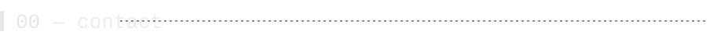
<a href="mailto:trunganhvu2611@gmail.com">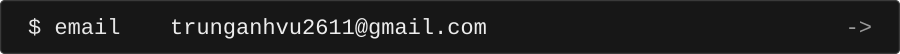</a>
<a href="https://www.linkedin.com/in/trunganhvu206">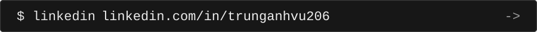</a>
<a href="https://github.com/trunganhvu206">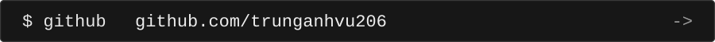</a>
<a href="https://trunganhvu206.github.io/trunganhvu206/">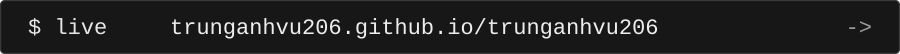</a>

  

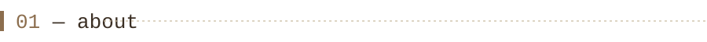
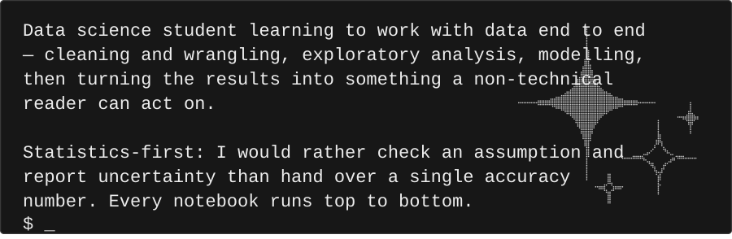

  

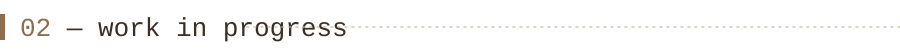
<a href="./PROJECTS.md">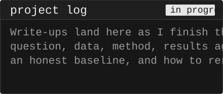</a>
<a href="./PROJECTS.md">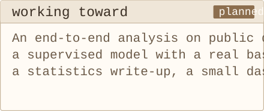</a>

  

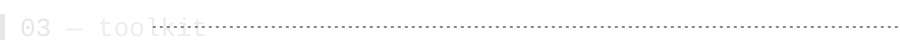
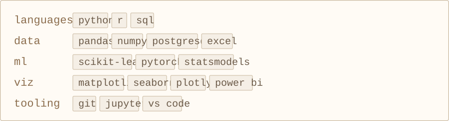

  

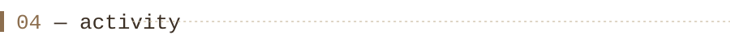

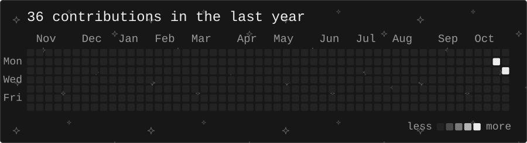

  

𑣲𝄞𝄞⋆ ݁♪ .⋆˚✰ ݁˖⭑.ᐟ˖ ݁♬⋆.˚𝄞⋆⭒˚.⋆☆

 

