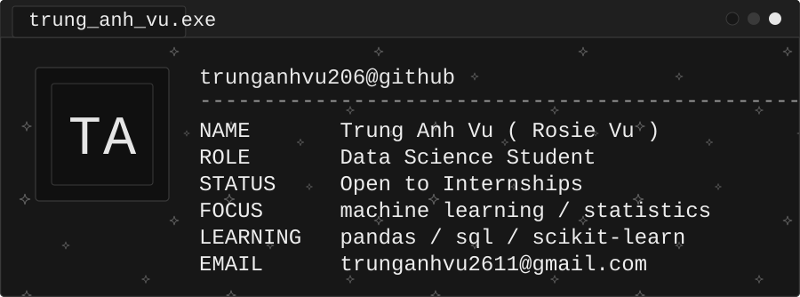
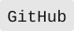
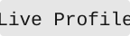
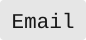
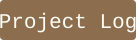
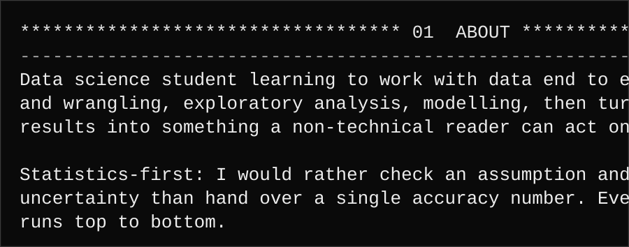
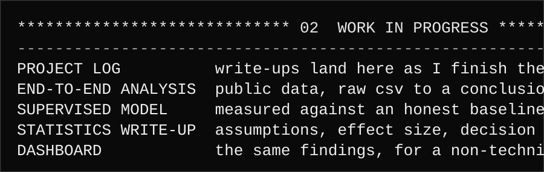
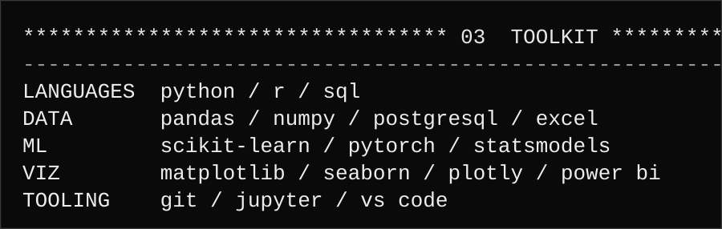
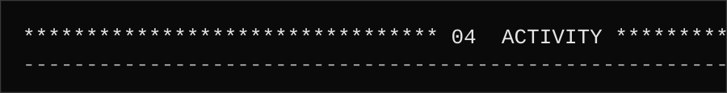
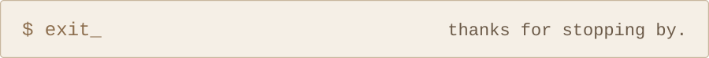

<!--
  Every image on this page is a generated SVG sharing one theme (scripts/theme.py):
  black terminal panels, VT323, banner headlines and LABEL/value rows.

  All copy lives in the PROFILE section of scripts/build_assets.py — edit it
  there and run `python scripts/build_assets.py` to regenerate assets/*.svg.
  The font is embedded per file (subset), because GitHub serves these as
  images and an image may not fetch an external font.
-->

  
  
  
  
  
  

  

  

  

  

